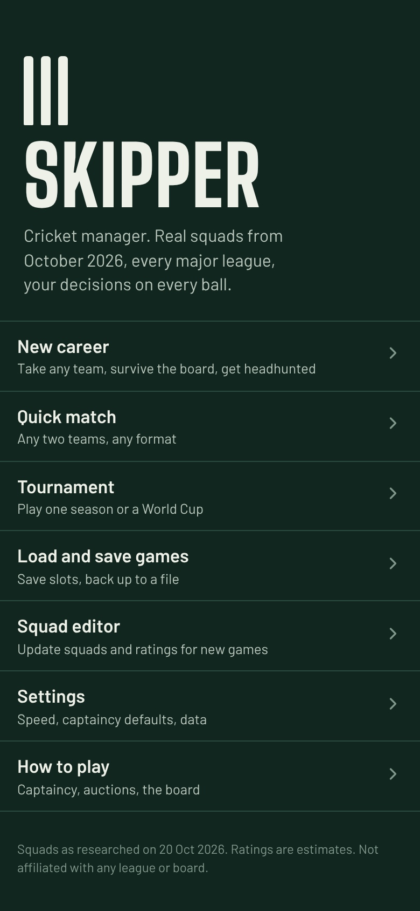
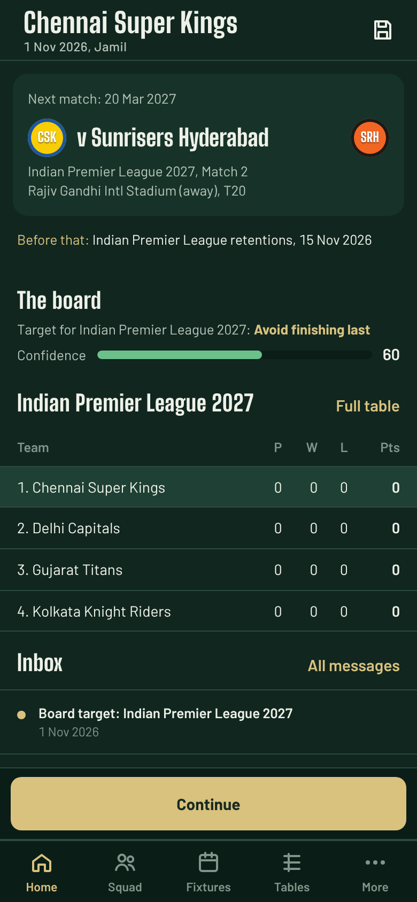
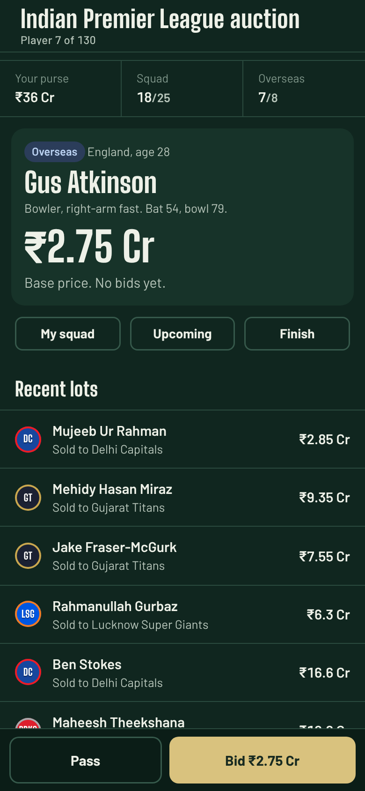
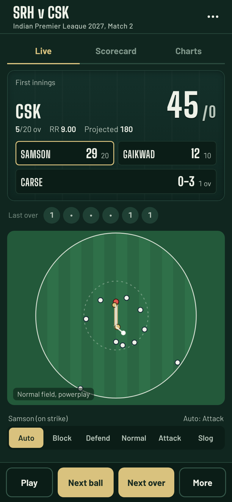
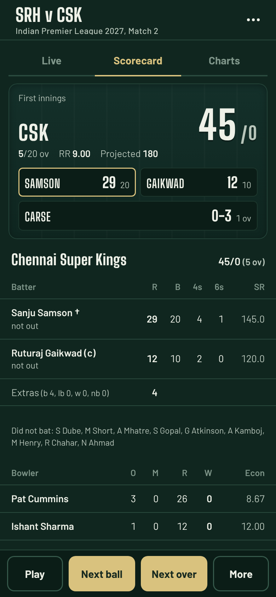
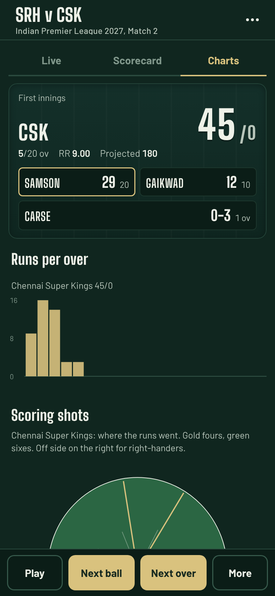
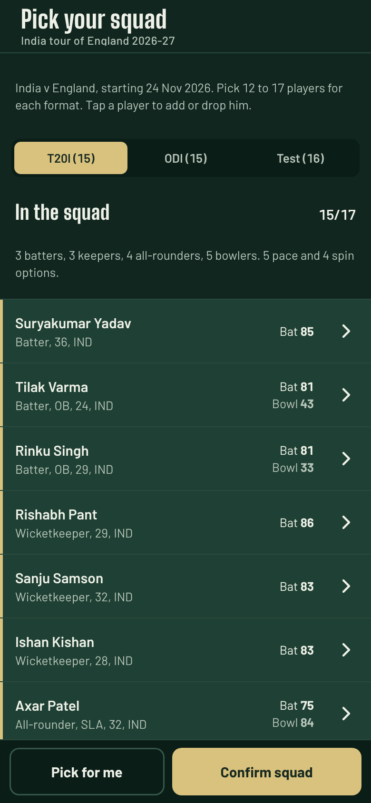

# Skipper — cricket manager (React + Android)

An offline cricket management and gameplay app in the style of *Cricket Captain*.
Real squads as of 20 October 2026, every major T20 league, Test cricket, a full career mode, and ball-by-ball captaincy.

Personal project. Not published on the Play Store.
The UI is a React app (Vite). Run it on your computer with hot reload, or build the Android APK from the same code.

| Menu | Career home | Auction | Live match |
|---|---|---|---|
|  |  |  |  |

| Scorecard | Charts | National squad |
|---|---|---|
|  |  |  |

## Features
- **Career mode:** coach any IPL, BBL, PSL, SA20, CPL, Hundred, ILT20, MLC, County Championship (Div 1 and 2) or Sheffield Shield team, or any of 21 national teams.
  - The board sets targets each season.
  - You can be sacked, or headhunted by other teams.
- **Formats:** Test, 4-day first-class, ODI, T20 and The Hundred.
- **Captaincy on every ball:**
  - Batting approach per batter, bowling changes and field settings
  - Declarations, follow-on, new ball and DRS
- **Match screens:** ball-by-ball commentary, a 2D field view, full scorecards, and charts (runs per over, the worm, scoring shots).
- **IPL-style retentions and live auctions** against AI teams, with a mega auction every 3 years.
- **National squads:** you pick the squad for every tour and every ICC event.
- **ICC events:** T20 World Cups, ODI World Cups, the Champions Trophy, and the World Test Championship with its final.
- **The wider world:** rankings, records, an honours list, ageing, retirements, and new young players every season.
- **Other modes:** quick match, single tournaments, and a squad editor with JSON import and export.
- **Fully offline:** no ads, no internet, no Android permissions.

## Run it on your computer (React dev server)
You need **Node 18 or newer** (https://nodejs.org).
```bash
npm install          # once; downloads React and Vite
npm run dev          # opens http://localhost:5173 with hot reload
```
- Edit any file in `src/` and the browser updates at once.
- Saves go to the browser's local storage (per address, so `localhost:5173` and a built copy don't share saves).
- To see the production build: `npm run build`, then open `dist/index.html` (it also works by double-click) or run `npm run preview`.

## Install on an Android phone
1. Copy `releases/Skipper-1.1.0.apk` to the phone and open it.
2. Allow installs from this source when Android asks. The app isn't from the Play Store, so this warning is expected.
3. Newer APKs from this repo install over older ones and keep your saves, because they share the same signing key.
4. **Uninstalling deletes your saves.** Export them first: Load and save → Export.

## Project layout
```
src/engine/   the game rules (plain JavaScript, no React): matches, world, auctions, career, saves
src/app/      app logic: navigation, overlays, the controller (save, Continue, routing)
src/components/  shared React pieces (Page, Router, Badge, sheets...)
src/screens/  one file per area: menu, hub, match, auction, editor
src/styles/   app.css
data_src/     squads and player ratings as plain text (edit these)
android/      Android wrapper: MainActivity.java (WebView + save-file bridge), manifest, icons
tools/        data builder, APK build script, signing key script, tests (Node and Playwright)
docs/         CONTEXT.md (full technical context: read this first), NOTES.md, screenshots
releases/     ready-to-install APKs
```

## Add a feature
- **A new screen:** create a component in `src/screens/`, add it to the map in `src/screens/index.js`, open it with `nav.go('name', params)`.
- **A change to game rules:** edit `src/engine/` (no React there). Check it with the Node tests below.
- **How state works:** the game world is one object, `app.world`. A screen changes it, then calls `nav.refresh()` to redraw. In the browser console you can inspect it with `SKR.app.world`.
- More detail in `docs/CONTEXT.md` section 8.

## Build the APK
You need Linux (Debian, Ubuntu, or WSL on Windows) and Node 18+.
```bash
sudo apt install aapt apksigner zipalign dalvik-exchange android-sdk-platform-23 \
                 android-framework-res openjdk-17-jdk-headless python3-cryptography nodejs npm
npm install
bash tools/build_apk.sh 1.1.1 4        # versionName, versionCode
# output: android/build/skipper.apk
```
- The script runs `npm run build` for you and packs `dist/` into the APK.
- **Always raise the versionCode.** 1.1.0 used code 3, so the next build needs 4 or higher, or Android refuses the update.
- `tools/make_key.py` recreates the same signing key on every machine, so updates install over old versions.

## Update squads and ratings
- **For the APK:** edit the text files in `data_src/` (formats are explained at the top of each file and in `docs/CONTEXT.md`). Then run:
  ```bash
  node tools/build_data.js     # rebuilds src/engine/data.js (never edit data.js by hand)
  ```
- **Inside the app:** use the Squad editor from the main menu. Its changes stay on that phone (export them as JSON to keep a copy).

## Tests
```bash
node tools/engine_check.js            # match engine consistency (720 matches)
node tools/sim_test.js T20 400        # scoring averages by format (POS=1 for batting positions)
node tools/world_test.js 3 IPL:CSK    # 3-season career with no UI
node tools/auction_test.js IPL 2027   # AI auction report
pip install playwright                # UI tests need Chromium: python3 -m playwright install chromium
npm run build                         # the UI tests open dist/index.html
python3 tools/ui/t3_match.py          # a T20 match by hand (t1..t6 cover the other screens)
python3 tools/ui/t7_season.py IPL:CSK 2 1   # plays 2 IPL seasons (with auctions) through the real buttons
python3 tools/ui/t8_screenshots.py    # refreshes docs/screenshots
```

## Continuing development
Read **`docs/CONTEXT.md`** first. It covers:
- the architecture and every data format
- how the game rules and AI work
- the build and signing details
- known bugs and the planned next steps

Any AI or developer can use it to pick up the work.

## Notes
- **Keep this repository private.** `tools/make_key.py` holds the passphrase that creates the signing key. Anyone with the repo could build an APK that installs over yours.
- **Data accuracy:** ratings, salaries and youth players are estimates. Tours beyond the known fixtures are generated by the game.
- **Fonts:** Barlow and Big Shoulders Display, under the SIL Open Font License (texts in `src/assets/fonts/`).
- **Code licence:** none chosen yet, so all rights are reserved by default.
- **Trademarks:** not affiliated with any league, cricket board or the Cricket Captain games. Team names are used for personal, non-commercial play.

## Versions
| Version | versionCode | Date | Notes |
|---|---|---|---|
| 0.9.0 | 1 | 20 Oct 2026 | Early test build |
| 1.0.0 | 2 | 21 Oct 2026 | Reworked auction AI, shared WTC final titles, faster Test skips, home screen shows next stop, editor fixes |
| 1.1.0 | 3 | 22 Oct 2026 | UI rewritten in React + Vite (run locally with `npm run dev`). Game rules and data unchanged. Editor pitch labels fixed |
